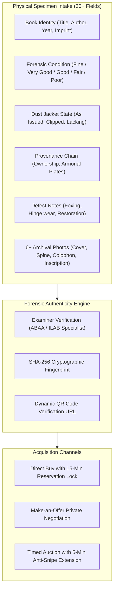
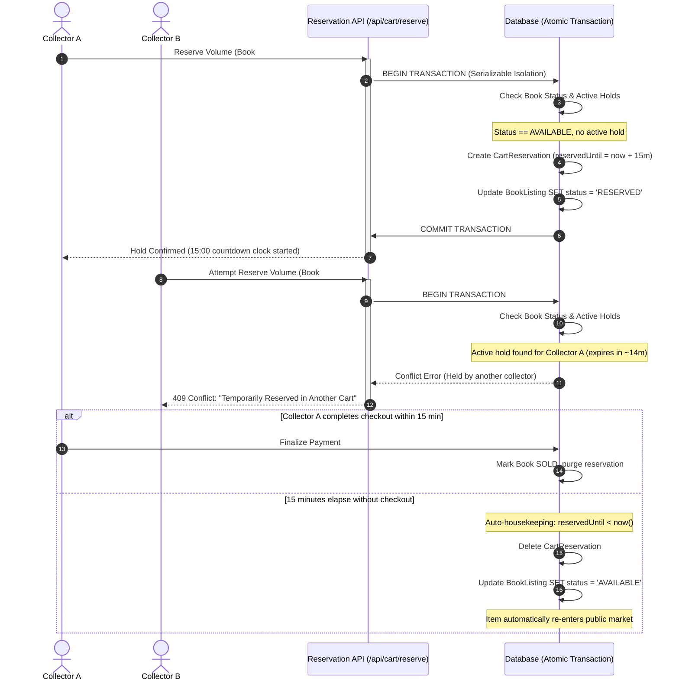
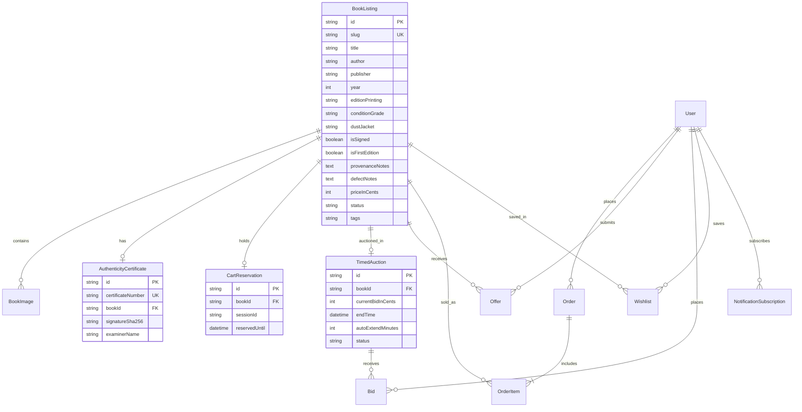

# The Antiquarian Guild: Concept, Domain Philosophy & Technical Whitepaper

> **An architectural and conceptual overview of an auction-house grade platform for rare books, incunabula, first editions, and historical manuscripts.**

---

## 1. The Founding Thesis: Why Traditional E-Commerce Fails for Antiquarian Books

Traditional e-commerce platforms (such as Amazon, Shopify, or eBay) are engineered around the premise of **fungible, multi-quantity inventory**:
* A stock-keeping unit (SKU) has a depth of inventory ($N > 1$).
* Two shoppers purchasing the same SKU receive identical mass-manufactured copies.
* Physical flaws are considered returns or warehouse defects.
* Pricing is fixed or determined by algorithmic discounting.

In the world of **antiquarian books and rare manuscripts**, almost none of these assumptions hold:
1. **Absolute Singularity ($\text{Quantity} = 1$):** Each physical specimen is a unique survivor of history. There are no two identical copies of an 1818 *Frankenstein*, an 1897 *Dracula* inscribed by Bram Stoker to his brother, or a 1623 Shakespeare First Folio leaf.
2. **Defect-Driven Value:** In rare books, age-induced patina, uncut deckle edges, binding repairs, foxing, price-clipped dust jackets, and early ink inscriptions are not defects—they are the **forensic identity** and primary determinants of value.
3. **The Contemplation Problem:** Discerning collectors and university libraries need time to scrutinize high-resolution photography, compare collation statements, and verify provenance before committing tens of thousands of dollars.
4. **The Collision Hazard:** If two institutional librarians simultaneously attempt to checkout the sole existing copy of a 1713 Newton *Principia*, traditional platforms permit a race condition where one buyer suffers a delayed failure or double-fulfillment catastrophe.

**The Antiquarian Guild** was engineered from first principles to bridge the physical prestige of institutions like Sotheby’s and Maggs Bros. with contemporary web architecture.

---

## 2. Core Domain Concepts & Physical Forensics



### 2.1 The ABAA / ILAB Grading Standard
Books in our catalog adhere to the standardized grading lexicon of the Antiquarian Booksellers’ Association of America:
* **Fine (F / As New):** Appears unread; crisp, clean, with zero defects.
* **Very Good (VG):** An exceptional collector copy with minimal signs of handling, sound hinges, and unmarred text leaves.
* **Good (G):** The traditional bookseller designation for a complete used copy with honest age wear.
* **Fair / Poor:** Worn historical survivor (chipped spine, detached boards, water stains), preserved for rarity or textual significance.

### 2.2 Forensic Defect Accounting
Unlike commercial listings that state "Used - Like New", each specimen features a dedicated **Forensic Defect Breakdown**:
* *Paper substrate analysis:* laid watermarked rag paper, wove paper, or handmade flower paper.
* *Binding structure:* contemporary morocco, calf with raised bands, diced russia, or original publisher's cloth.
* *Jacket status:* whether the original unclipped currency price is intact or restoration has been applied.

---

## 3. The 15-Minute Concurrency Reservation Engine

The central technical innovation of the store is the **concurrency-safe temporary exclusivity lock**.



### 3.1 Implementation Details
* **Atomic PostgreSQL/SQLite Transactions:** Handled via `prisma.$transaction(async (tx) => ...)`.
* **State Machine Invariant:**
  $$\text{Status} \in \{\text{AVAILABLE}, \text{RESERVED}, \text{SOLD}, \text{IN\_AUCTION}\}$$
* **Stale Expiry Resolution:** Rather than relying exclusively on a background cron process that might have execution delay, every reservation check and cart heartbeat (`/api/cart/status`) dynamically purges reservations whose `reservedUntil \le \text{now()}` and reverts unpurchased books to `AVAILABLE`.

---

## 4. Payment Integrity & Idempotent Checkout

Transactions are integrated with **Razorpay test sandbox** using cryptographic signature verification.

### 4.1 Payment Verification Architecture
1. **Order Initiation (`/api/checkout/create-razorpay-order`):**
   * Verifies that all cart items still possess valid reservation holds belonging to the requester's `sessionId`.
   * Sums exact database valuations (preventing client-side price tampering).
   * Generates a pending database `Order` with a unique human-readable tracking number (e.g. `ORD-2026-89412`).
2. **Cryptographic Verification (`/api/checkout/verify`):**
   * Validates the Razorpay HMAC SHA-256 signature:
     $$\text{Signature} = \text{HMAC-SHA256}(\text{order\_id} \mathbin{\Vert} \text{payment\_id}, \text{secret})$$
   * Inside an atomic transaction:
     - Updates `Order.status = 'PAID'` and records `razorpayPaymentId`.
     - Updates `BookListing.status = 'SOLD'`.
     - Deletes the `CartReservation` entries.
3. **Idempotency Webhook (`/api/checkout/webhook`):**
   * If a client's browser disconnects immediately after payment approval, Razorpay's asynchronous webhook listeners process `order.paid` or `payment.captured` idempotently without double-marking or duplicating records.

---

## 5. Anti-Snipe Timed Auctions

Rare book auctions often suffer from "auction sniping"—automated bots placing bids in the final fraction of a second to prevent legitimate collectors from reacting.

### 5.1 The 5-Minute Auto-Extension Rule
If a bid is registered when:
$$\Delta t = t_{\text{end}} - t_{\text{now}} \le 5\text{ minutes}$$
The platform dynamically recalculates:
$$t_{\text{end}} \leftarrow t_{\text{now}} + 5\text{ minutes}$$

This ensures that any last-minute counter-bid affords the opposing collector a full 5-minute contemplation window to respond, mimicking traditional physical auction gallery room etiquette.

```
Scheduled Close: 14:00:00
Bid Placed:      13:58:30 (1m 30s remaining <= 5m)
New Close:       14:03:30 (Extended by 5m from bid time)
```

---

## 6. Cryptographic Certificates of Authenticity

Every qualified specimen receives an immutable digital Certificate of Authenticity (`/certificate/[certificateNumber]`):
1. **Deterministic Identity:** Formatted as `CERT-[YEAR]-[SLUG]-[SUFFIX]`.
2. **Cryptographic SHA-256 Fingerprint:**
   $$\text{Hash} = \text{SHA256}(\text{Title} \mathbin{\Vert} \text{Author} \mathbin{\Vert} \text{Year} \mathbin{\Vert} \text{Edition} \mathbin{\Vert} \text{Examiner})$$
3. **Dynamic QR Code Resolution:** An onboard QR generation module converts the public verification URL into an inline SVG/PNG matrix. Scanning the physical printed certificate leads directly to the live verification page.
4. **Print Stylesheet:** Custom CSS `@media print` rules format the certificate with an ornate gold double-fillet border, watermark seal, and examiner endorsement block for framing.

---

## 7. Make-an-Offer Negotiation Desk

For institutional acquisitions or high-value titles (\$10,000+), collectors frequently request custom terms or institutional pricing.

* **Buyer Proposal:** Buyer submits an offered price, contact information, and acquisition rationale (e.g., permanent donation to a university library).
* **Curator Workbench (`/admin/offers`):**
  - **Accept:** Authorizes buyer to reserve and complete checkout at the agreed lower valuation.
  - **Counter:** Senior curator sets a counter-offer price with an explanatory note and a 48-hour acceptance window.
  - **Decline:** Formal rejection with courteous reasoning.

---

## 8. Technology Stack & Architectural Decisions

| Layer | Technology | Decision Rationale |
| :--- | :--- | :--- |
| **Framework** | Next.js 16 (App Router) | Server Components for instant catalog rendering; Client Components for countdown timers and interactive galleries. |
| **Styling** | Tailwind CSS v4 | Warm editorial palette (`#FDFBF7` parchment, `#1A1816` archival ink, `#B38838` antique gilt), deckle edge borders. |
| **Typography** | Cormorant Garamond & Inter | Editorial serif typography for titles; clean legible sans for dense forensic metadata. |
| **Database** | SQLite / PostgreSQL via Prisma | Strict relational schemas, foreign-key cascade rules, and ACID transactions. |
| **Authentication**| NextAuth (JWT Session) | Role-Based Access Control (`CUSTOMER` vs `ADMIN`) with credentials and session persistence. |
| **Payments** | Razorpay SDK (Test Mode) | Comprehensive sandbox support, test cards helper, and HMAC SHA-256 signature verification. |
| **Testing** | Vitest | Sub-second execution of concurrency locks, double-booking prevention, and anti-snipe logic. |

---

## 9. Comprehensive Database Schema (ERD)



---

## 10. Summary

The Antiquarian Guild demonstrates how rigorous software engineering principles—transactional concurrency, cryptographic proofs, and domain-driven design—can be united with the classic elegance of antiquarian book curation.
